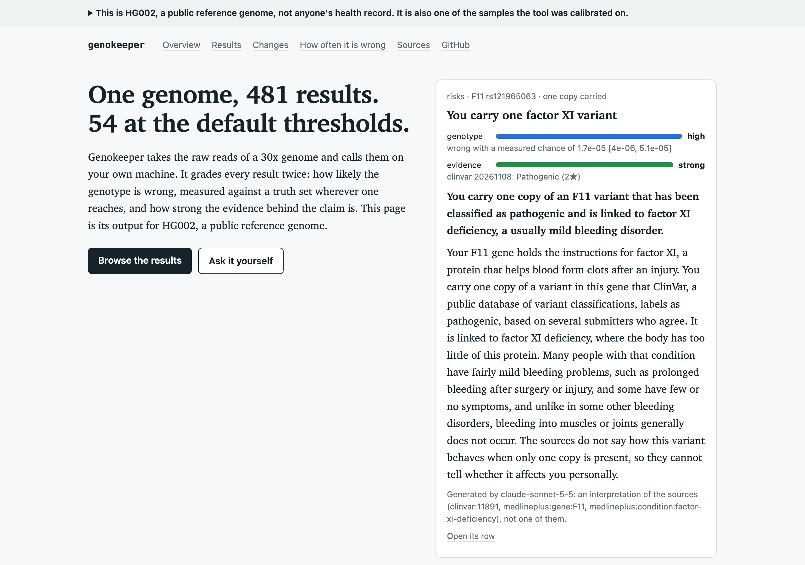
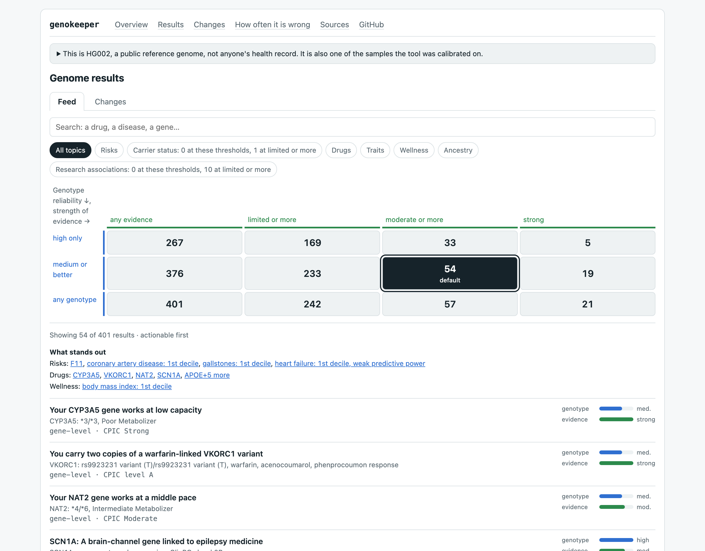

# Genokeeper

[](https://github.com/genokeeper/genokeeper/actions/workflows/ci.yml)
[](LICENSE)
[](https://www.bestpractices.dev/projects/16523)
[](https://doi.org/10.5281/zenodo.24134245)

> **Not medical advice, not a medical device.** This is a research tool a person runs on their
> own genome; nothing it reports is a diagnosis or a basis for a medical decision.

A local analyser for your own whole-genome sequencing data. It takes the raw paired reads of a
30x WGS run, aligns them to GRCh38 and calls them on your own machine. It grades every genotype
call with an error rate measured on public reference samples (GIAB's HG002, HG003 and HG004). When
you run `genokeeper refresh`, it fetches the newest releases of ClinVar, ClinGen, GenCC, CPIC,
ClinPGx and the GWAS Catalog and grades your calls on them again. An optional daily check tells you
when a newer release is out. It never runs the refresh for you.

**As far as we know, a first.** As of November 2026 we found no other open-source personal-genome
tool that shows, on each genotype call, the chance it is wrong as measured on Genome in a Bottle
samples in its own calibration runs, next to an evidence level that quotes the curator. Nor one
that combines this with calling the raw reads on your own machine, grading the same calls again
on new releases with a diff per result, plain-language explanations labelled with the model and
the sources they were written from, a command an AI agent can query, and a public demo built from
a reference sample's own reads.

**Nothing leaves your machine unless you ask.** Genokeeper has no telemetry, no analytics and
no crash reporting. The pipeline never uploads your reads, genotypes or findings. The
aligner and its helpers (bwa, samtools, bcftools, mosdepth) run on your machine and open no
connection of their own; every other tool that reads your data runs in a container with no
network; and a run opens no connection at all.
Two optional features send finding data to Anthropic, and only when you use them: the
`genome-ask` skill in your own Claude Code session, and `genokeeper explain`.
[Privacy and network](#privacy-and-network) lists every connection the tool makes and how to
check the claim yourself.

**Supported input (this version):** one pair of FASTQ files (`*.fq.gz` or `*.fastq.gz`) from an
original DNBSEQ-T7 run of about 30x, as tellmeGen delivers it, for example. Reads from another
sequencer, Illumina included, are refused with the reason, because the variant caller's model
and every calibration sample are T7's. BAM, CRAM and VCF input are not supported yet.

**Requirements:**
- a Mac with Apple silicon and 48 GB of memory or more: Docker needs 36 GB of it, and macOS
  needs the rest. It is the only platform tested so far; Linux, Intel Macs and WSL2 are
  tracked in [#48](https://github.com/genokeeper/genokeeper/issues/48);
- about 1.5 TB of downloads, and 1 TB of free disk at the peak; about 0.85 TB stays after
  calibration, and about 0.5 TB once you free what may go ([Freeing disk](#freeing-disk) adds
  it up);
- several days of mostly unattended downloading and computing before the first graded result;
- optional: [Claude Code](https://claude.com/claude-code), for the `genome-ask` skill and
  `genokeeper explain`. Both use your own Claude Code login, so they count against your Claude
  plan's usage, or are billed per token if Claude Code runs on an API key.

[Quick start](#quick-start) takes a fresh Mac from nothing to the dashboard, step by step. The
maintainers' detail (each tool, each calibration measurement, how a run and a refresh behave)
is in [docs/reference.md](docs/reference.md).

## See it

Except the HG002 demo at its end, everything in this section is made from an invented genome,
not anyone's results.

**Ask your agent.** The `genome-ask` skill answers questions about your genome in a Claude
Code session from `genokeeper query`. Every claim comes with how reliable the genotype is and how
strong the evidence behind it is. The skill never chooses a drug or a dose for you. Here is a
real, unedited session on the invented genome:


Other questions it answers the same way:
- "Am I a carrier of anything my children could inherit?" It lists the carrier findings, how
  sure each genotype is, and the genes this run could not assess.
- "What do my results say about heart disease?" It gives the ClinVar findings and the
  polygenic scores, each score as a percentile with its population and its predictive power.
- "Do I have the factor V Leiden variant?" It reports the genotype at the site, from
  `genokeeper genotype`.
- "What changed since the last update?" It reports what the last refresh graded again, from
  `genokeeper changes`.

**The dashboard.** `genokeeper dashboard` writes one static page of every finding. It has a
3x4 matrix of thresholds, genotype reliability down the side and strength of evidence across,
each cell counting the findings it keeps and choosing them on a click; topic chips; and a
search box.
Below the list, the page counts what the chosen cell hides and why.

A whole genome yields thousands of candidate findings, and most rest on an uncertain genotype or
weak evidence. Each finding carries two measures:
- how likely its genotype is wrong, measured on reference samples;
- how strong the evidence behind its claim is.

**The HG002 demo.** The same pipeline run on GIAB's HG002, a public reference genome, is at
[genokeeper.github.io/genokeeper](https://genokeeper.github.io/genokeeper/). In the matrix's
loosest cell, any genotype and any evidence, HG002 has 481 results; at the default thresholds,
54 remain, and 5 at high reliability and strong evidence. The site shows what a newer ClinVar
release changed and how often each kind of call is wrong, with the samples it was measured on.
`uvx genokeeper demo` (macOS or Linux) puts the same store in a folder you can ask questions
about.





An open row shows its genotype, its evidence and sources, and, once `genokeeper explain` has run,
a short gist and a plain-language explanation. The page labels both with the model that wrote
them and the sources it was given.

The invented genome below, made to touch every topic, shows 2,405 findings in the loosest cell
and 18 at the default thresholds. Its page, recording and screenshot are of an earlier version,
with two sliders where the matrix now is.


To try the page yourself, download [docs/demo/dashboard.html](docs/demo/dashboard.html) and open
it in a browser. It loads nothing from the network.


**Language.** Text is in English by default. `GENOKEEPER_LANG=ru`, or `--lang ru` on
`dashboard` and `explain`, switches the dashboard, the explanations and the update notices to
Russian. The skill answers in the language you ask in.

## Quick start

From a fresh Apple-silicon Mac to the dashboard and the agent skill, in the order that works.
The order matters. The reference samples are cut down to the number of bases your own reads
hold, so your FASTQ goes through a first `genokeeper run` before they are fetched. Times are
rough, for a recent Mac that meets the requirements; downloads take as long as your connection
makes them. Every download step can be rerun: it resumes a cut transfer and skips what is done.
Read [Terms you accept](#terms-you-accept) before step 5.

**1. Prerequisites.**
- Xcode's command line tools (`xcode-select --install`) and [Homebrew](https://brew.sh).
- uv and seqtk: `brew install uv seqtk`. The bootstrap installs neither. Nothing checks for
  seqtk until a reference sample is cut down (steps 7 and 8), and those steps stop without it.
- Rosetta (`softwareupdate --install-rosetta`): eight of the pinned images are published for
  Intel (linux/amd64) only.
- [Docker Desktop](https://www.docker.com/products/docker-desktop/), running for every step
  below. In Settings, Resources, give it 36 GB of memory or more. In Settings, General, keep
  "Use Rosetta for x86_64/amd64 emulation on Apple Silicon" on.
- Optional: [Claude Code](https://claude.com/claude-code), for step 10's skill and `explain`.

**2. Clone and install.** uv fetches the Python the project pins.

```bash
git clone https://github.com/genokeeper/genokeeper.git && cd genokeeper
uv sync
git config core.hooksPath .githooks
```

The hooks run the genome-data guard before every commit and push, so your data cannot be
committed by mistake.

**3. Choose where the lab goes.** The lab is the folder of tools, references and reference
samples; the bootstrap fills `~/genome-lab/`. To put it on another disk, set
`$GENOKEEPER_HOME` in your shell profile now. Every command reads it. Set it before step 5: the
lab records absolute paths, so moving it later is not supported.

```bash
echo 'export GENOKEEPER_HOME=/Volumes/Data/genome-lab' >> ~/.zshrc && source ~/.zshrc
```

Your run's own outputs (the store, the alignment, the dashboard) go to `reports/` inside the
checkout, so clone onto a disk with room for your FASTQ pair and about 100 GB more.

**4. Put your reads in `data/raw/` and check their platform.** Exactly two FASTQ files,
`*.fq.gz` or `*.fastq.gz`, from a DNBSEQ-T7 run. The run pairs them in name order, so read 1's
file must sort first (`…_1.fq.gz`, `…_2.fq.gz`). A delivery split into lanes is concatenated
into one pair first, the lanes in the same order on both sides, and the lane files kept outside
`data/raw/` (gzip files concatenate into a valid gzip file):

```bash
mkdir -p data/raw
cat L01_1.fq.gz L02_1.fq.gz > data/raw/genome_1.fq.gz
cat L01_2.fq.gz L02_2.fq.gz > data/raw/genome_2.fq.gz
```

Then check, in seconds and before any download, that the reads come from the platform this
version supports. With nothing else installed yet, the first run checks read 1's first 100,000
reads and stops:

```bash
uv run genokeeper run
```

On a DNBSEQ-T7 it goes on to say the gnomAD table of step 5 is missing, which is expected now.
Reads from another platform are refused with what they are instead (see
[Troubleshooting](#troubleshooting)), so you find out before any download.

If the delivery has a 23andMe-format genotype file (`*.txt`, not `*.vc.txt`), put it beside
the FASTQ: the run checks the sample's identity against it, and records "not checked" without
it.

**5. Bootstrap the lab.** It installs the command line tools through Homebrew, pulls or
builds the pinned container images, and downloads the references and knowledge bases. It
streams gnomAD's 0.88 TB once to build a table of a few GB. Hours at 100 MB/s, a day or more on
a slower line.

```bash
bash scripts/bootstrap.sh --check   # what is missing; changes nothing
bash scripts/bootstrap.sh --with-gnomad --with-vep --with-masked-reference --with-sv --with-typing
```

`--check` lists every missing file of every step, whatever `--with-…` flags you give it, and
exits 0. The one exception is the two publication sources (LitVar2's variants file and
ClinVar's citations, about 2.2 GB, used for no grading): they are listed and fetched only with
`--with-publications`. A line that ends "(run with --with-vep)" says which flag fetches the file; it reads
the same when you gave that flag. The lines for the reference samples (HG002, HG003, HG004 and
their truth sets) name no flag: they belong to step 7. It checks the container images only
while Docker is running.

Leave out `--with-hg002` and `--with-hg004` for now. They cut the samples down to your run's
bases, so before step 6 they only wait for that run (the bootstrap says so and goes on).

**6. First run: alignment and QC.** Step 5 must be complete: `run` refuses without the gnomAD
table that `--with-gnomad` builds, and names the flag. The run checks that the reads come from
a T7, aligns them with bwa to GRCh38 (about 5 to 6 hours), refuses a sample whose alignment
fails the QC gate (depth, mapping, duplicates, insert size, contamination), and records your
run's bases. With no calibration table yet it then stops with exit code
2. That is expected: "this run has recorded its … bases, which `genokeeper calibrate`
downsamples HG003 to; the calibration table at … is not calibrated". The alignment is cached,
and step 9 does not repeat it.

```bash
uv run genokeeper run
```

**7. Fetch the reference samples.** HG003's FASTQ (147 GB, kept until step 8 cuts it down),
HG002's two libraries (300 GB read, one file of about 150 GB on disk at a time, about 170 GB of
cut-down reads kept), HG004's library (144 GB read whole, then cut down) and GIAB's truth sets
for the three:

```bash
bash scripts/bootstrap.sh --with-calibration --with-hg002 --with-hg004
```

Then align them, each like a run (hours apiece):

```bash
uv run python -m genokeeper.calibrate.hg002 align pcrfree  # HG002 PCR-free: aligned and called
uv run python -m genokeeper.calibrate.hg002 align pcr      # HG002 PCR: aligned only
uv run python -m genokeeper.calibrate.hg002 align hg004    # refused unless HG004 shows as female
uv run python -m genokeeper.calibrate.hg002 accept hg004   # accepted at SNP F1 0.99 or more
```

**8. Calibrate.** It builds every calibration table in order. The first, `small_variants`,
cuts HG003 down to your bases, deletes the 147 GB download, aligns and calls HG003, and scores
it against GIAB's truth. The others measure the structural, repeat, copy-number, sex-dosage and
typing calls on the aligned samples. A table whose inputs are missing is skipped with one line
naming the command that supplies them (exit code 2); a rerun builds only what is still stale.
Expect a day or more.

```bash
uv run genokeeper calibrate
```

A shorter path to a first result: in step 7 fetch only `--with-calibration` and skip the
`align` commands, then run `uv run genokeeper calibrate --only small_variants`. The run then
grades the small variants, and every structural, repeat, copy-number, sex-dosage and typing
statement reads "not calibrated" until the rest is done. It saves about 450 GB of downloads.

**9. Second run.** It reuses the alignment, then calls, phases, annotates and grades
everything into `reports/genomelab.duckdb`, printing the identity verdict and an accounting of
every source. Most of a day. SpliceAI is the slowest part, and its time grows with the number
of your variants in the genes it scores: the code measured one SpliceAI process at 1,224 s on
1,757 of HG003's sites, and four at 597 s (`src/genokeeper/annotate/vep.py`). A run starts one
SpliceAI process per three of its threads.

```bash
uv run genokeeper run
```

**10. Read the results.**

```bash
uv run genokeeper dashboard   # writes reports/dashboard.html; open it in a browser
uv run genokeeper query       # the findings at the default thresholds
```

For the agent skill, start Claude Code in the checkout (`claude`) and ask in plain words: "am
I a carrier of anything?" The skill sends the `genokeeper query` answers it reads to Anthropic
through your Claude Code session. The optional `genokeeper explain` sends findings to
Anthropic as well. No other step sends your data off the machine.

**11. The daily update check (optional).** It notifies you when a source has a newer release.
It never fetches or grades anything: you run `uv run genokeeper refresh` when you choose.

```bash
brew install terminal-notifier       # open its app once for the permission prompt
uv run genokeeper schedule install
```

Approve the agent once under System Settings → General → Login Items & Extensions → "Allow in
the Background".

## Commands

Each command prints its options with `--help`. The ones a new user meets:

| Command | Does |
|---|---|
| `run` | aligns, calls and grades `data/raw/`'s FASTQ pair into the store. `--fastq1` and `--fastq2` name other files (both or neither); `--clinvar38 PATH` grades on that ClinVar GRCh38 VCF instead of the newest in the lab; `--genotypes PATH` names the 23andMe-format file; `--sex male\|female` overrides the sex read from chrX depth; `--threads N` |
| `query`, `show`, `genotype` | read the store: the findings at the filters, one statement in full, the answer at a gene's or marker's sites; `--json` prints what the skill reads |
| `dashboard` | writes `reports/dashboard.html` |
| `explain` | asks Claude Code for a plain explanation of each finding not explained yet; `--dry-run` prints every prompt and the call count and sends nothing |
| `refresh` | fetches the newest knowledge-base releases and grades your calls on them; `--explain` also explains the new findings |
| `changes` | what changed between two snapshots (one per run). By default it compares the latest run with the previous refresh's run; `--base RUN_ID` compares with another snapshot, `--run RUN_ID` picks the newer one. It lists only what entered or left the trusted findings; `--all` lists every change |
| `check-updates` | the update check by hand; `--notify` sends the notification |
| `schedule install`, `schedule uninstall` | the daily update check |
| `calibrate` | rebuilds every stale calibration table; `--only NAME` builds one (`small_variants`, `hg002_cells`, `stage3`, `deletions`, `cnv`, `insertions`, `paralogs`, `foundation`, `slice3f`), `--report` prints what each measured |
| `build-faf` | builds the gnomAD table (`bootstrap.sh --with-gnomad` runs it). With no option it streams each chromosome the table lacks or whose source changed; `--chrom chr1` (repeatable) builds that chromosome; `--check` lists the chromosomes the table lacks and uses no network |

`run` and `query` print the run id (`run <id>`).

## Terms you accept

The repository's own code is AGPL (see [Licence](#licence)). The tools and data the bootstrap
fetches keep their own terms, and you accept them by running the bootstrap. No step asks you to
click through them, so read these first:

- **Aldy** calls CYP2D6 and CYP2B6. Its licence, from the Indiana University Research and
  Technology Corporation (IURTC), permits non-commercial research only. It excludes clinical
  trials and diagnostic use without IURTC's written consent, and forbids processing data for a
  third party or distributing the software. Running the lab on someone else's genome for them
  is processing for a third party. The bootstrap builds Aldy's image from `docker/`; after that,
  this prints the licence:

  ```bash
  docker run --rm --network none "$(uv run python -c 'from genokeeper.containers import IMAGES; print(IMAGES["aldy"])')" aldy license
  ```
- **SpliceAI's models and scores** are CC BY-NC 4.0: non-commercial use only. The bootstrap
  builds SpliceAI's image with them.
- **The PGS Catalog's scoring files** come under each score's own terms: cite the score's
  publication, follow its authors' restrictions and EBI's terms of use. Each score's terms are
  in `src/genokeeper/resources/pgs/scores.toml` (`licence`).
- **StellarPGx** (a third CYP2D6 caller) is MIT-licensed.
- **hmmix** (the Neanderthal share) ships the GPL-3.0 text in its wheel, while PyPI and its
  repository say MIT. It runs here for you and is never redistributed.
- **Docker Desktop** has its own terms, which it shows the first time it starts; you accept them
  there.

Other non-commercial terms apply to REVEL's scores, AlphaMissense's predictions, Scramble and
ClinPGx's annotations; [Licence](#licence) lists them, and
[docs/reference.md](docs/reference.md#building-the-store) gives every tool's terms.

## Keeping it up to date

**The knowledge bases.** Run `uv run genokeeper refresh` when you want new releases, for example
when the daily check notifies you. It fetches each source's newest file, runs `genokeeper run`
only when a grading input, a calibration table or Genokeeper's own code changed, and shows the result in the dashboard's Changes tab and in
`genokeeper changes`. For a new ClinVar release it never re-aligns or re-calls your reads, nor
runs VEP and SpliceAI again. After Genokeeper's own code changed, its run redoes every step the
change touched, which can be any of them, VEP and SpliceAI included. The pinned tools and data
(gnomAD, the PGS Catalog, VEP, PharmCAT and others) are reported when newer, never applied: they
change only with a new version of Genokeeper.

**Genokeeper itself.**

```bash
git pull
uv sync
bash scripts/bootstrap.sh --with-gnomad --with-vep --with-masked-reference --with-sv --with-typing
uv run genokeeper calibrate
uv run genokeeper run
```

The bootstrap, run again with the flags you used, fetches or builds only what the new version
pins differently. A new version can change the pipeline (a tool, an image, a flag). Each
calibration table records the pipeline it was measured on, so a change makes it stale. `run`
then refuses while the small-variant table is stale, naming `genokeeper calibrate`; a stale
table for another kind of call leaves those statements unassessed. `genokeeper calibrate`
rebuilds only the stale tables and says "current" for the rest. If the change touched your own
steps, the run redoes only those; a changed aligner re-aligns.

After a change to the variant caller (DeepVariant's image, checkpoint or command line), no
calibration table uses calls the old caller made ([BR-043](docs/bugs/BR-043.md)): the tables
measured on them read stale, and `genokeeper calibrate` refuses naming the library to call
again. `uv run python -m genokeeper.calibrate.hg002 recall <library>` calls that library's
recorded alignment again, with nothing re-aligned and no download (hours per library). For
HG004, run `accept hg004` after it. Then run `genokeeper calibrate` again.

## Freeing disk

Where the space goes. The numbers are approximate; each names its source.

| What | Where | About | Source |
|---|---|---|---|
| tools, references, knowledge bases (step 5) | the lab | 100 GB | a rough estimate, not measured by the code |
| the 37 container images | Docker's virtual disk | 50 GB | their sizes as `docker image inspect` reports them on a built lab |
| your FASTQ pair | `data/raw/` | its own size, F below | |
| your run: alignment, cached steps, store | `reports/` | 100 GB, 45 GB of it the alignment | a rough estimate, not measured by the code |
| HG003's download (steps 7 to 8) | the lab | 147 GB | the bootstrap |
| HG004's download (step 7, while it is cut down) | the lab | 144 GB | the bootstrap |
| HG002's cut-down reads | the lab | 170 GB | the bootstrap |
| HG003's and HG004's cut-down reads | the lab | F each | they hold your run's bases |
| four aligned reference libraries | the lab | 45 GB each | a rough estimate, not measured by the code |

HG002's 170 GB for two cut-down pairs suggests F is about 85 GB for a 30x run.

- **Peak:** in step 8, just before `calibrate` deletes HG003's download. On disk then: the lab,
  the images, your FASTQ and run, HG003's download and its cut-down reads, HG002's and HG004's
  cut-down reads, and three aligned libraries. That is about 700 GB plus 3F, so about 950 GB.
  Keep 1 TB free.
- **After calibration:** about 600 GB plus 3F, so about 850 GB.
- **After freeing what is listed below:** about 430 GB plus F, so about 0.5 TB.

May be deleted once `genokeeper calibrate` says every table is current:
- HG004's cut-down reads: `uv run python -m genokeeper.calibrate.hg002 clean hg004`.
- HG002's and HG003's cut-down reads, by hand: the lab's
  `calibration/hg002/pcrfree/downsampled/`, `calibration/hg002/pcr/downsampled/` and
  `calibration/hg003/downsampled/`. While a library keeps its alignment record nothing reads
  them: the bootstrap fetches nothing for such a library, and a re-alignment writes the reads
  back from its alignment.
- After a re-alignment, `clean <library>` deletes the old alignment and the reads the new one
  was made from.
- Docker's build cache: `docker builder prune`. Keep the images: a run never pulls one.

Keep:
- `reports/work/`, above all your alignment. `refresh` and every later `run` reuse it; without
  it a run aligns again (about 5 to 6 hours).
- `reports/genomelab.duckdb`, the store: it holds every run's snapshot that `changes` compares.
- your FASTQ pair in `data/raw/`: every run checks it.
- the aligned reference libraries and their `aligned.json` records under the lab's
  `calibration/`: `calibrate` rebuilds a stale table from them.
- the rest of the lab.

## Uninstall

```bash
uv run genokeeper schedule uninstall          # removes the daily check, if you installed it
uv run python -c 'from genokeeper.containers import IMAGES; print("\n".join(IMAGES.values()))' \
  | xargs docker image rm                     # removes the pinned images
rm -rf "${GENOKEEPER_HOME:-$HOME/genome-lab}" # removes the lab
```

Then delete the checkout. It holds your FASTQ in `data/raw/` and your results in `reports/`, so
move out what you want to keep first. Remove the `GENOKEEPER_HOME` line from your shell profile
if you added one. The Homebrew formulas the bootstrap installed (bcftools, samtools, htslib,
bwa, mosdepth, openjdk, openjdk@21) and the ones you installed (uv, seqtk, terminal-notifier)
can go with `brew uninstall` if nothing else needs them.

## Troubleshooting

**Docker memory.** A run warns when Docker gives its containers less than 36 GiB: the
polygenic scores' matching steps (pgsc_calc's FORMAT_SCOREFILES and MATCH_COMBINE) peaked at
34.6 GB on a 30x genome and can fail out of memory below it. Raise it in Docker Desktop,
Settings, Resources. DeepVariant sizes its work to Docker's memory, so less memory only makes
it slower. Docker with 36 GB needs a Mac with 48 GB or more; running the scores in smaller
batches to lower this is tracked in [#50](https://github.com/genokeeper/genokeeper/issues/50).

**Rosetta.** Eight images (DeepVariant, VerifyBamID2, mutserve, WhatsHap, OptiType, T1K,
bigBedToBed and StellarPGx) are Intel-only. They need Rosetta installed
(`softwareupdate --install-rosetta`) and Docker Desktop's "Use Rosetta for x86_64/amd64
emulation on Apple Silicon" on.

**Reads from another platform.** The run reads the flowcell id in the read names and the base
qualities. A DNBSEQ-G400 run (flowcell `V…`), a DNBSEQ-T7+ run (flowcell `ML…`, or qualities
binned to four levels), Illumina and other platforms are refused, naming what was found. This
version has no path for them: the variant caller's model and every calibration sample are the
original T7's.

**A QC refusal.** The QC gate judges a sample twice. After alignment, before calling, it reads
mean depth, the share of bases at 20x, mapped reads, duplicates, insert size and contamination;
a refusal there comes in step 6. After DeepVariant has called, it reads Ti/Tv and the het/hom
ratio as well; a refusal on those comes only in step 9, because the first run stops before
calling. The message names the metric. The bounds and their sources are in
`config/grading.toml` under `[qc]`. A sample that fails is a question for your sequencing
provider. Changing a bound is your own decision, and it changes what the next refresh re-runs.

**Disk running out.** Three steps check the free space first and refuse with "… needs N GB free
in …, M GB is", keeping 20 GB to spare: downloading HG002's and HG004's libraries, cutting
HG002's down, and re-aligning a reference library from its alignment. The others do not check:
HG003's 147 GB download, cutting HG003 and HG004 down, and every other step fail with their
tool's own error when the disk fills. Free space as
[Freeing disk](#freeing-disk) says, then run the same command again: downloads resume where they
stopped, and finished steps are not redone.

**`bootstrap --check` still lists the reference samples after step 5.** That is expected. It
lists the inputs of every step whatever `--with-…` flags you give it (only LitVar2's file and
ClinVar's citations wait for `--with-publications`), and the reference samples (HG002,
HG003, HG004 and their truth sets) come in step 7. Their lines go once step 7 has fetched them.
HG002's and HG004's cut-down reads stay listed until a first run has recorded your bases.

## Privacy and network

Genokeeper has no telemetry, no analytics, no crash reporting and no account. The list below is
every connection it makes, followed by the evidence that the rest of it makes none.

**Offline by construction.** Once the bootstrap has built the lab, these commands work with the
network off: `genokeeper run`, `query`, `show`, `genotype`, `changes` and `dashboard`.
- bwa, samtools, bcftools and mosdepth read your reads and calls on the host, as installed by
  Homebrew; none of them makes a network call of its own.
- Every other tool that reads them runs in a pinned container started with
  `--network none --pull never`. Genokeeper starts each such container in one place:
  `run_container` in `src/genokeeper/containers.py`, tested in `tests/test_containers.py`.
- The two Nextflow pipelines, pgsc_calc and StellarPGx, start their tasks' containers
  themselves. Each task gets `--network none`, Nextflow runs with `NXF_OFFLINE` set, and
  `check_containment` reads every task's launch line after the run and refuses results whose
  container lacked the flag (`src/genokeeper/prs/pgsc.py`, `src/genokeeper/pgx/stellarpgx.py`).
- VEP runs with `--offline` on its local cache.
- `test_a_run_opens_no_network_connection` (in `tests/test_pipeline_invariants.py`) runs the
  whole pipeline on a mini genome with every name lookup and socket connection refused. The
  run completes and attempts none.
- The dashboard is one static page whose Content-Security-Policy is `default-src 'none'`, so it
  can load nothing. A PubMed link opens only when you click it.

**What goes out, and when:**

| Command | Goes to | Sends |
|---|---|---|
| `bash scripts/bootstrap.sh` | the download hosts of the tools and references ([docs/reference.md](docs/reference.md#building-the-store)) | requests for public files, each checked by its checksum; Homebrew runs with `HOMEBREW_NO_ANALYTICS=1`, and rtg-tools runs with crash reports and usage logging off |
| `genokeeper refresh` | the same public release hosts | requests for public files |
| `genokeeper check-updates`, and the daily check if you install it (`genokeeper schedule install`) | the release endpoints of ClinVar, ClinGen, GenCC, ClinPGx, the GWAS Catalog, MedlinePlus, LitVar, CGD, the PGS Catalog, gnomAD and CSpec, and GitHub's release API | version requests, with no sample, run or user identifier |
| `genokeeper demo` | GitHub: the `hg002` release of `genokeeper/hg002-demo` | requests for the demo's manifest, store and refresh-log record, each checked by its sha256 |
| `python -m genokeeper.demo build` (maintainer only) | NCBI's ClinVar archive | requests for ClinVar 20260503, its `.md5` and its `.tbi` |
| `genokeeper explain` or `genokeeper refresh --explain` (opt-in) | Anthropic, through your own Claude Code login | for each finding and watch item (a borderline repeat, an SMN1 silent-carrier marker) not yet explained: its gene, variant, your genotype and the claim (`--dry-run` prints every prompt first) |
| the `genome-ask` skill, if you ask questions through Claude Code (opt-in) | Anthropic, through your own Claude Code session | the `genokeeper query`, `show`, `genotype` and `changes` answers the agent reads in order to answer you |

Nothing in the table runs on its own except the daily check, which you install yourself. The
last two rows are the only ones that send finding data, and only when you ask a question or run
`explain`.

**Without a language model.** Nothing needs one.
- The dashboard shows every finding with its sources, and leaves the explanation empty until
  you run `genokeeper explain`.
- `query`, `show` and `genotype` print the store's data as it is.

**Your data and git.** `data/raw/` and `reports/` never enter git: `.gitignore` excludes them,
and the genome-data guard (`scripts/check_no_genome_data.sh`, run by the hooks of step 2 and in
CI) refuses genomic files and data files outside the data folders. List your kit or sample ID,
one extended regular expression per line, in `.git/info/genome-private-ids` (never committed),
and the guard refuses it too. Claude Code sessions in the checkout cannot read `data/raw/`,
`reports/` or the lab's `calibration/` with their file tools; a lab moved by `$GENOKEEPER_HOME`
is outside that rule. [docs/reference.md](docs/reference.md#data) gives the details and limits.

**Outside Genokeeper.** Docker Desktop sends its own usage statistics unless you turn them off in
its settings.

**Check it yourself.** After the bootstrap, turn the network off and run `uv run genokeeper run`
and `uv run genokeeper dashboard`. Or watch the processes with an outbound firewall (LuLu, Little
Snitch).

## Built on

Genokeeper runs these tools and reads these truth sets and knowledge sources, in pipeline
order. The papers describe the tools, not Genokeeper's own accuracy, and no group listed
here endorses its output. What Genokeeper measured itself, and on which samples, is in
[docs/reference.md](docs/reference.md) and on the HG002 demo's
[calibration page](https://genokeeper.github.io/genokeeper/calibration.html).

**Reads to calls.**
- [GRCh38 reference assembly](https://doi.org/10.1101/gr.213611.116): Schneider et al., Genome Res 2017.
- [GIAB GRCh38 with GRC false duplications masked](https://doi.org/10.1038/s41587-021-01158-1): Wagner et al., Nat Biotechnol 2022.
- [BWA-MEM](https://doi.org/10.48550/arXiv.1303.3997): Li, arXiv 2013.
- [SAMtools](https://doi.org/10.1093/gigascience/giab008): Danecek et al., GigaScience 2021.
- [BCFtools](https://doi.org/10.1093/gigascience/giab008): Danecek et al., GigaScience 2021.
- [mosdepth](https://doi.org/10.1093/bioinformatics/btx699): Pedersen and Quinlan, Bioinformatics 2018.
- [VerifyBamID2](https://doi.org/10.1101/gr.246934.118): Zhang et al., Genome Res 2020.
- [DeepVariant](https://doi.org/10.1038/nbt.4235): Poplin et al., Nat Biotechnol 2018.
- [mutserve (mtDNA-Server)](https://doi.org/10.1093/nar/gkw247): Weissensteiner et al., Nucleic Acids Res 2016.
- [WhatsHap](https://doi.org/10.1101/085050): Martin et al., bioRxiv 2016.

**Truth sets and calibration.**
- [Genome in a Bottle reference samples (HG002, HG003, HG004)](https://doi.org/10.1038/sdata.2016.25): Zook et al., Sci Data 2016.
- [GIAB v4.2.1 small-variant benchmarks (HG003, HG004)](https://doi.org/10.1016/j.xgen.2022.100128): Wagner et al., Cell Genom 2022.
- [GIAB HG002 v5.0q benchmark (T2T Q100 v1.1 assembly)](https://doi.org/10.1101/2025.09.21.677443): Hansen et al., bioRxiv 2025.
- [GIAB genome stratifications v3.6](https://doi.org/10.1038/s41467-024-53260-y): Dwarshuis et al., Nat Commun 2024.
- [RTG Tools vcfeval](https://doi.org/10.1101/023754): Cleary et al., bioRxiv 2015.

**Structural variants, copy number and repeats.**
- [DELLY](https://doi.org/10.1093/bioinformatics/bts378): Rausch et al., Bioinformatics 2012.
- [Dysgu](https://doi.org/10.1093/nar/gkac039): Cleal and Baird, Nucleic Acids Res 2022.
- [Truvari](https://doi.org/10.1186/s13059-022-02840-6): English et al., Genome Biol 2022.
- [CNVpytor](https://doi.org/10.1093/gigascience/giab074): Suvakov et al., GigaScience 2021.
- [INSurVeyor](https://doi.org/10.1038/s41467-023-38870-2): Rajaby et al., Nat Commun 2023.
- [SCRAMble](https://doi.org/10.1038/s41436-020-0749-x): Torene et al., Genet Med 2020.
- [ExpansionHunter](https://doi.org/10.1093/bioinformatics/btz431): Dolzhenko et al., Bioinformatics 2019.
- [REViewer](https://doi.org/10.1186/s13073-022-01085-z): Dolzhenko et al., Genome Med 2022.
- [STRchive](https://doi.org/10.1186/s13073-025-01454-4): Hiatt et al., Genome Med 2025.
- [SMNCopyNumberCaller](https://doi.org/10.1038/s41436-020-0754-0): Chen et al., Genet Med 2020.
- [Parascopy](https://doi.org/10.1038/s41467-022-30930-3): Prodanov and Bansal, Nat Commun 2022.
- [Gauchian](https://doi.org/10.1038/s42003-022-03610-7): Toffoli et al., Commun Biol 2022.
- [KILDA](https://doi.org/10.1093/nargab/lqaf070): Molitor et al., NAR Genom Bioinform 2025.

**Pharmacogenomics.**
- [PharmCAT](https://doi.org/10.1002/cpt.1568): Sangkuhl et al., Clin Pharmacol Ther 2020.
- [Aldy](https://doi.org/10.1101/gr.277075.122): Hari et al., Genome Res 2023.
- [BCyrius](https://doi.org/10.1002/prp2.70065): Halman and Conyers, Pharmacol Res Perspect 2025.
- [StellarPGx](https://doi.org/10.1002/cpt.2173): Twesigomwe et al., Clin Pharmacol Ther 2021.
- [CPIC](https://doi.org/10.1038/clpt.2010.279): Relling and Klein, Clin Pharmacol Ther 2011.
- [PharmGKB / ClinPGx clinical annotations](https://doi.org/10.1002/cpt.2350): Whirl-Carrillo et al., Clin Pharmacol Ther 2021.

**Clinical and population evidence.**
- [ClinVar](https://doi.org/10.1093/nar/gkae1090): Landrum et al., Nucleic Acids Res 2025.
- [ClinGen](https://doi.org/10.1056/NEJMsr1406261): Rehm et al., N Engl J Med 2015.
- [ClinGen gene-disease validity](https://doi.org/10.1016/j.ajhg.2017.04.015): Strande et al., Am J Hum Genet 2017.
- [ClinGen dosage sensitivity](https://search.clinicalgenome.org/kb/gene-dosage): ClinGen Dosage Sensitivity Curation.
- [ClinGen SVI BA1 exception list](https://doi.org/10.1002/humu.23642): Ghosh et al., Hum Mutat 2018.
- [GenCC](https://doi.org/10.1016/j.gim.2022.04.017): DiStefano et al., Genet Med 2022.
- [Clinical Genomic Database (CGD)](https://doi.org/10.1073/pnas.1302575110): Solomon et al., Proc Natl Acad Sci USA 2013.
- [ACMG SF v3.3 secondary findings list](https://doi.org/10.1016/j.gim.2025.101454): Lee et al., Genet Med 2025.
- [ACMG carrier screening tiers (2021)](https://doi.org/10.1038/s41436-021-01203-z): Gregg et al., Genet Med 2021.
- [gnomAD v4.1 (allele frequencies and SV sites)](https://doi.org/10.1038/s41586-023-06045-0): Chen et al., Nature 2024.
- [Filtering allele frequency (FAF)](https://doi.org/10.1038/gim.2017.26): Whiffin et al., Genet Med 2017.
- [MANE transcripts](https://doi.org/10.1038/s41586-022-04558-8): Morales et al., Nature 2022.
- [MITOMAP](https://doi.org/10.1002/0471250953.bi0123s44): Lott et al., Curr Protoc Bioinformatics 2013.
- [Genomics England PanelApp](https://doi.org/10.1038/s41588-019-0528-2): Martin et al., Nat Genet 2019.
- [GWAS Catalog](https://doi.org/10.1093/nar/gkae1070): Cerezo et al., Nucleic Acids Res 2025.
- [LitVar 2.0](https://doi.org/10.1038/s41588-023-01414-x): Allot et al., Nat Genet 2023.
- [MedlinePlus Genetics](https://medlineplus.gov/genetics/): National Library of Medicine, MedlinePlus Genetics.

**Variant effect prediction.**
- [Ensembl VEP](https://doi.org/10.1186/s13059-016-0974-4): McLaren et al., Genome Biol 2016.
- [SpliceAI](https://doi.org/10.1016/j.cell.2018.12.015): Jaganathan et al., Cell 2019.
- [REVEL](https://doi.org/10.1016/j.ajhg.2016.08.016): Ioannidis et al., Am J Hum Genet 2016.
- [AlphaMissense](https://doi.org/10.1126/science.adg7492): Cheng et al., Science 2023.
- [SpliceVault](https://doi.org/10.1038/s41588-022-01293-8): Dawes et al., Nat Genet 2023.
- [pext (proportion expressed across transcripts)](https://doi.org/10.1038/s41586-020-2329-2): Cummings et al., Nature 2020.
- [UCSC NMD Escape track (MANE)](https://genome.ucsc.edu/cgi-bin/hgTrackUi?db=hg38&g=nmd): UCSC Genome Browser, NMD Escape track.

**Polygenic scores and ancestry.**
- [PGS Catalog](https://doi.org/10.1038/s41588-021-00783-5): Lambert et al., Nat Genet 2021.
- [pgsc_calc](https://doi.org/10.1038/s41588-024-01937-x): Lambert et al., Nat Genet 2024.
- [Nextflow](https://doi.org/10.1038/nbt.3820): Di Tommaso et al., Nat Biotechnol 2017.
- [PLINK 2](https://doi.org/10.1186/s13742-015-0047-8): Chang et al., GigaScience 2015.
- [FRAPOSA](https://doi.org/10.1093/bioinformatics/btaa152): Zhang et al., Bioinformatics 2020.
- [HGDP + 1000 Genomes reference panel (gnomAD v3.1)](https://doi.org/10.1101/gr.278378.123): Koenig et al., Genome Res 2024.
- [fastmixture](https://doi.org/10.24072/pcjournal.503): Santander et al., Peer Community J 2024.
- [hmmix](https://doi.org/10.1371/journal.pgen.1007641): Skov et al., PLoS Genet 2018.

**Haplogroups, HLA and other typing.**
- [Haplogrep 3](https://doi.org/10.1093/nar/gkad284): Schönherr et al., Nucleic Acids Res 2023.
- [PhyloTree Build 17](https://doi.org/10.1016/j.fsigss.2015.09.155): van Oven, Forensic Sci Int Genet Suppl Ser 2015.
- [haplocheck](https://doi.org/10.1101/gr.256545.119): Weissensteiner et al., Genome Res 2021.
- [Yleaf](https://doi.org/10.1093/molbev/msy032): Ralf et al., Mol Biol Evol 2018.
- [OptiType](https://doi.org/10.1093/bioinformatics/btu548): Szolek et al., Bioinformatics 2014.
- [T1K](https://doi.org/10.1101/gr.277585.122): Song et al., Genome Res 2023.
- [IPD-IMGT/HLA](https://doi.org/10.1093/nar/gkac1011): Barker et al., Nucleic Acids Res 2023.
- [RBCeq2](https://github.com/limcintyre/RBCeq2): McIntyre et al., RBCeq2 v2.4.4 (software) 2026.
- [BCFtools/RoH](https://doi.org/10.1093/bioinformatics/btw044): Narasimhan et al., Bioinformatics 2016.

## Licence

Genokeeper's own code is licensed under the GNU Affero General Public License, version 3 or any
later version ([LICENSE](LICENSE)). You may use, change and share it. If you share a changed
version, or offer it to others over a network (a hosted service included), you must make its
source available under the same licence. Running it for yourself requires nothing.
[NOTICE](NOTICE) lists the third-party data the repository carries and their terms. Among them
are Illumina's repeat catalog, STRchive's thresholds, ClinGen's and GenCC's data, MITOMAP, RBCeq2,
PharmCAT's example report, and the HLA table derived from PharmGKB.

The tools and data the bootstrap fetches keep their own licences
([docs/reference.md](docs/reference.md#building-the-store) sets them out), and each user
downloads them from their sources. Six are non-commercial only:
- Aldy;
- REVEL's scores;
- the SpliceAI models (CC BY-NC 4.0);
- AlphaMissense's predictions (CC BY-NC-SA 4.0);
- Scramble (CC BY-NC-SA 4.0);
- ClinPGx's current download (CC BY-NC-SA 4.0).

IPD-IMGT/HLA's `hla.dat` is CC BY-ND 4.0. T1K builds its index from it in the lab, and that
adaptation is never distributed. T1K is MIT-licensed and OptiType BSD-3-Clause.

So the pipeline as a whole is for non-commercial use, whatever the AGPL allows for the code. The
container images built from `docker/` must not be published, because Aldy's licence forbids
distributing it.

Not medical advice and not a medical device.
